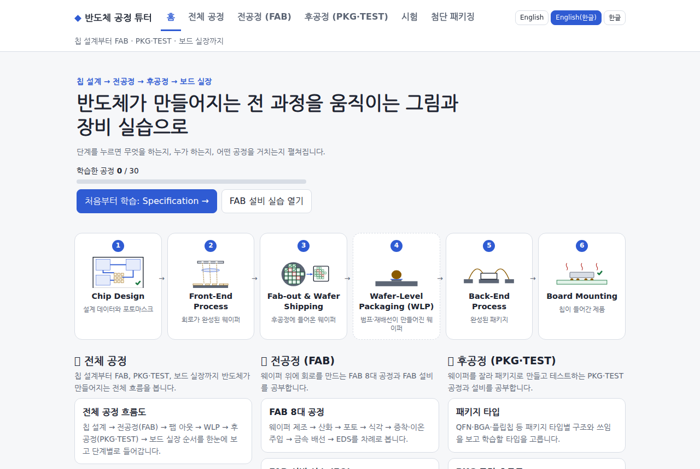
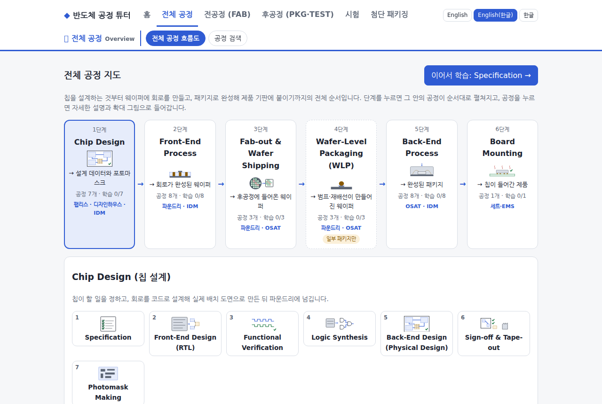
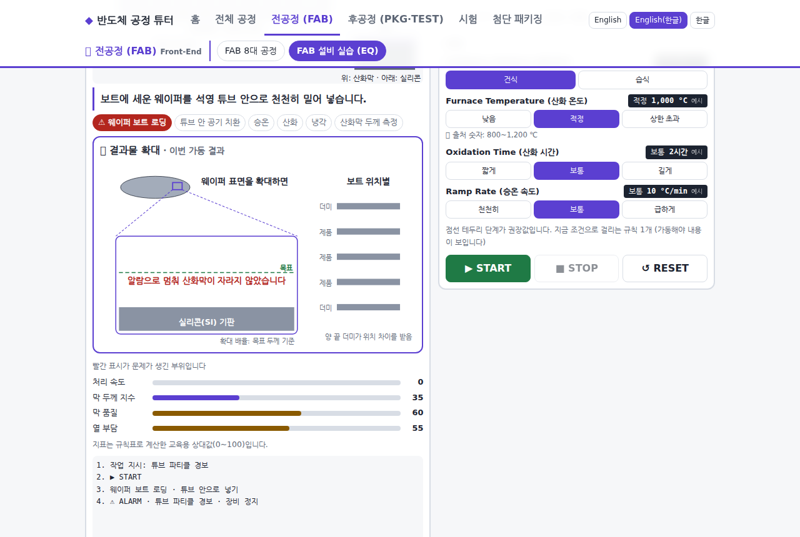

# 반도체 공정 튜터

칩 설계부터 전공정(FAB), 후공정(PKG·TEST), 보드 실장까지 **반도체 전체 공정을 흐름과 인과로 배우는 학습 웹 앱**입니다.
공정 하나를 따로 외우는 대신, 앞 공정의 결과가 다음 공정의 조건을 어떻게 바꾸는지 그림과 장비 실습으로 익힙니다.

> 개인 프로젝트 · 2026-10 ~ 진행 중 · AI 코딩 도구(Claude Code)와 함께 기획·개발



## 왜 만들었나
반도체 전체 공정은 범위가 너무 넓고 내용이 많아 한 번에 보기도, 쉽게 이해하기도 어려웠습니다.
흩어진 자료로는 "왜 이 공정이 이런 조건으로 진행되는지"가 연결되지 않아, **직접 만들면서 이해하기 위해** 시작했습니다.

## 주요 기능
| 영역 | 내용 |
|---|---|
| 전체 공정 지도 | 칩 설계 → 전공정 → 팹 아웃·웨이퍼 출하/입고 → 웨이퍼 레벨 패키징 → 후공정 → 보드 실장, 6단계 36개 공정. 단계별 담당 회사 유형(팹리스·파운드리·OSAT·IDM 등) 표시 |
| 공정 설명 | 입력·결과, 세부 단계, 핵심 용어, 선행 공정, 움직이는 개념도, "비유로 쉽게 보기", 출처 |
| 설비 실습 (EQ) | 장비 14대(FAB 6대 + PKG·TEST 8대). 조건을 정하고 START → 가동 로그 → 이상 시 **알람 정지** → 원인·조치·근거 출처 |
| 상황 실습 | 작업 지시서와 목표를 받고, 블레이드 교체·드레싱·패드 세정 같은 조치를 골라 문제 해결 |
| 라인 연결 실습 | 앞 장비의 조건이 뒤 장비 상태를 바꿈 (예: 백그라인딩을 얇게 → 다이싱에 얇은 웨이퍼 도착). 최종 판정: 정상 / 신뢰성 위험 / 불량 |
| 확대해서 보기 | 장비 → 부품 → 원리 단위까지 단계별 확대 애니메이션 (예: 쏘 → 블레이드 → 다이아몬드 입자) |
| 시험 | 앱 데이터로 만든 문제, 연습/실전, 오답 노트, 선택형 AI 문제 생성 |
| 첨단 패키징 | 2.5D, 3D, 칩렛 등 핵심 공정과 기본 공정의 연결 |
| FAB 공정 시뮬레이션 | 산화 → 포토 → 식각 → 증착 → 이온 주입 → 금속 배선 조건을 바꾸며 웨이퍼 단면과 판정을 봄. 6공정 연결 시 앞 공정이 뒤 공정 상태를 바꿈 |
| 현장 실무 훈련 | FAB 3개·PKG 4개 가상 사건을 초기 대응 → 데이터 수집 → 원인 분석 → 조치·검증 → 평가(100점)로 풂. 연습/평가 모드, 가상 시간, 장비 도식·차트·애니메이션 |
| 분석 도구 | 불량 분석 도감, 공정 데이터 분석(관리도·Cp/Cpk·Pareto), 엔지니어 보고서(8D·5 Why·피시본) |
| 내 학습 | 대시보드, 학습 일정, 노션식 노트, 학습 분석, 구글 로그인 동기화(선택) |





## 신뢰성을 지키는 방법
AI는 근거가 없어도 자연스러운 문장을 만들 수 있습니다. 공정 조건과 불량의 관계가 틀리면 학습자가 틀린 원인을 외우게 되므로, **AI의 말이 아니라 확인된 근거가 결과를 정하도록** 설계했습니다.

1. **판정은 규칙표로만**: 설비·라인 시뮬레이션의 판정은 데이터 규칙표로 계산하고 AI나 무작위 값을 쓰지 않습니다.
2. **직접 확인한 숫자만**: 장비사 기술 문서와 공개 논문에서 직접 읽은 값만 출처 숫자로 쓰고, 나머지는 "예시"로 표시합니다. 초록만 읽은 자료는 "초록 기준"으로 표시합니다.
3. **출처 2등급**: 근거 출처(논문, 공개 표준, 공개 로드맵·공공기관 보고서)를 판정 근거로 씁니다. 근거 출처를 찾지 못한 설비 규칙·시나리오 원인에 한해 설명 출처(대학 공개 강의, 업체 기술 문서, 업계 전문 매체)를 쓰고, 화면에 "설명 출처"로 표시합니다(PRD v2 예외 규정). 개인 블로그는 쓰지 않습니다.
4. **검수 전 표시**: 전문가 검수를 받기 전의 내용은 화면에 "검수 전"으로 표시합니다.
5. **자동 검사**: `npm run check-machines`가 모든 조건 조합을 실행해 "권장 조건이면 정상인가", "모든 상황 실습에 해결 방법이 있는가", 출처 키와 단계 번호가 맞는지 검사합니다. 현재 14대 모두 통과합니다.
6. **그림과 사진**: 개념도는 직접 그린 SVG입니다. 실제 사진은 재사용이 허락된 것(CC BY 등)만 저작자·라이선스와 함께 싣고, 나머지는 원본 링크로만 연결합니다. 실제 사진을 찾지 못한 경우는 "실제 사진 아님"을 표시한 그림으로 대신합니다.
7. **AI 튜터 (선택)**: 사용자 본인의 Claude API 키로 동작하며, 앱의 공정·장비 데이터만 근거로 답하고 근거가 없으면 "앱 자료에서 확인되지 않음"이라고 답합니다. 키는 사용자 브라우저에만 저장됩니다.

## AI와 함께 개발한 방식
- 기획서([docs/PRD.md](docs/PRD.md)), 구조도([docs/architecture.md](docs/architecture.md)), 와이어프레임([docs/wireframe.md](docs/wireframe.md))을 먼저 작성했고, 완성 뒤 각 문서 아래에 최종본(v2)을 덧붙였습니다. 이어받기 기록은 [docs/handoff.md](docs/handoff.md)에 있습니다.
- AI 코딩 도구가 지켜야 할 작업 규칙을 [CLAUDE.md](CLAUDE.md)에 정했습니다. 공정 데이터는 데이터 파일에만 두고, 출처나 검수 표시를 지어내지 않으며, 판정에 AI를 쓰지 않는 등의 규칙입니다.
- 기능을 작게 나눠 여러 AI 에이전트에게 병렬로 맡기고, 결과를 합칠 때 생긴 이름 충돌은 에이전트별 이름 규칙과 병합 후 빌드·자동 검사로 해결했습니다.
- 출처 조사 기록: [review/sources-notes.md](review/sources-notes.md), [review/machine-sources.md](review/machine-sources.md)
- 전문가 검수표(자동 생성): [review/review-sheet.md](review/review-sheet.md)

## 현재 한계
- 전문가 검수와 실제 학생 대상 테스트는 아직 진행하지 않았습니다. 모든 내용은 "검수 전" 상태입니다.
- 설비 규칙 175개 중 65개와 현장 시나리오 일부 원인은 설명 출처에 기대고 있어, 1순위 출처로 바꾸는 중입니다.
- 시뮬레이션은 실제 장비 수치 계산이 아니라 경향을 보여주는 교육용 규칙입니다.

## 실행 방법
```bash
cd app
npm install
npm run dev            # 개발 서버
npm run build          # 배포용 빌드
npm run check-machines # 설비 규칙표 자동 검사
npm run review-sheet   # 전문가 검수표 다시 만들기
npm run check-content  # 출처·시나리오·미디어 자동 검사
```

### 필요한 키 이름 (선택)
`app/.env`에 넣습니다(커밋하지 않음, 예시는 `app/.env.example`). 비워 두면 로그인 없이 브라우저 저장으로 동작합니다.
- `VITE_SUPABASE_URL` — Supabase 프로젝트 주소
- `VITE_SUPABASE_ANON_KEY` — Supabase anon(공개) 키

AI 기능(선택)은 앱 안에서 본인의 Claude API 키를 넣으면 쓸 수 있고, 키는 그 브라우저에만 저장됩니다. 배포·로그인 설정은 [docs/배포-로그인-설정.md](docs/배포-로그인-설정.md)를 봅니다.

기술: React 19, Vite 8, JavaScript, Anthropic SDK(선택 기능), 브라우저 localStorage(학습 기록)
