# 반도체 패키징 공정 튜터 · 전문가 검수표 (QFN)

만든 날짜: 2026-10-31 · 공정 데이터에서 자동으로 만든 문서입니다.

## 부탁드리는 내용

반도체 패키징을 처음 배우는 대학생(전자·재료·기계공학 3–4학년)을 위한 학습 앱을 만들고 있습니다.
앱에 들어갈 공정 설명이 맞는지 확인해 주시면, 검수 결과를 앱에 "검수됨"으로 표시하겠습니다.

- 항목마다 **맞음 / 고칠 곳 / 모름** 중 하나에 표시해 주세요. 잘 모르는 항목은 "모름"으로 두셔도 됩니다.
- 학생용이라 일부러 단순하게 썼습니다. 단순화는 괜찮지만 **틀린 내용**이 있으면 알려 주세요.
- 라인 실습의 등급(권장/주의/불량)은 실제 수치가 아니라 경향을 보여주는 교육용 규칙입니다. 경향이 맞는지만 봐 주세요.
- 공정은 16개(전공정 8개, 후공정 8개)입니다. 일부 공정만 보셔도 됩니다.

## 검수자 정보

| 항목 | 내용 |
|---|---|
| 성함 | |
| 소속·경력 | |
| 검수 날짜 | |
| 앱에 표시할 이름 | ☐ 실명 ☐ 소속·경력만 (예: 현직 패키징 엔지니어 1인) ☐ 표시하지 않음 |

## 공정별 검수

### 1. 웨이퍼 제조 (Wafer Fabrication) · 전공정

| 항목 | 앱에 보이는 내용 | 판단 | 고칠 곳·의견 |
|---|---|---|---|
| 설명 | 고순도 실리콘을 녹여 기둥(잉곳)으로 키운 뒤 얇게 잘라 표면을 매끄럽게 연마해 웨이퍼를 만듭니다. | ☐ 맞음 ☐ 고칠 곳 ☐ 모름 | |
| 입력 | 고순도 실리콘 | ☐ 맞음 ☐ 고칠 곳 ☐ 모름 | |
| 결과 | 표면이 연마된 빈 웨이퍼 | ☐ 맞음 ☐ 고칠 곳 ☐ 모름 | |
| 핵심 용어 | 잉곳 (Ingot), 단결정 (Single Crystal), 연마 (Polishing) | ☐ 맞음 ☐ 고칠 곳 ☐ 모름 | |
| 바로 앞에 알아야 할 공정 | 없음 (첫 공정) | ☐ 맞음 ☐ 고칠 곳 ☐ 모름 | |
| 비유 (단순화 설명) | 김밥을 길게 말아 한 줄로 만든 뒤 얇게 썰어 단면을 매끈하게 다듬는 일과 비슷합니다. 썬 한 장 한 장이 웨이퍼입니다. | ☐ 맞음 ☐ 고칠 곳 ☐ 모름 | |
| 개념도 | 아래 그림 | ☐ 맞음 ☐ 고칠 곳 ☐ 모름 | |

**등록된 출처** (내용과 맞는지 봐 주세요)

- [[반도체 8대 공정] 1탄, '웨이퍼'란 무엇일까요?', publisher: '삼성전자 반도체 뉴스룸 (삼성반도체이야기)', url: 'https://news.samsungsemiconductor.com/kr/%eb%b0%98%eb%8f%84%ec%b2%b4-8%eb%8c%80-%ea%b3%b5%ec%a0%95-1%ed%83%84-%ec%9b%a8%ec%9d%b4%ed%8d%bc%eb%9e%80-%eb%ac%b4%ec%97%87%ec%9d%bc%ea%b9%8c%ec%9a%94/](undefined) · undefined · 설명 출처

**이 공정의 근거로 추천할 자료**(교재, 논문, 표준 등): 

---

### 2. 산화 (Oxidation) · 전공정

| 항목 | 앱에 보이는 내용 | 판단 | 고칠 곳·의견 |
|---|---|---|---|
| 설명 | 웨이퍼를 높은 온도에서 산소나 수증기와 반응시켜 표면에 얇은 산화막(SiO₂)을 만듭니다. 산화막은 절연막과 보호막 역할을 합니다. | ☐ 맞음 ☐ 고칠 곳 ☐ 모름 | |
| 입력 | 빈 웨이퍼 | ☐ 맞음 ☐ 고칠 곳 ☐ 모름 | |
| 결과 | 산화막이 덮인 웨이퍼 | ☐ 맞음 ☐ 고칠 곳 ☐ 모름 | |
| 핵심 용어 | 산화막 (Oxide Layer), 절연 (Insulation), 산화로 (Furnace) | ☐ 맞음 ☐ 고칠 곳 ☐ 모름 | |
| 바로 앞에 알아야 할 공정 | 웨이퍼 제조 (Wafer Fabrication) | ☐ 맞음 ☐ 고칠 곳 ☐ 모름 | |
| 비유 (단순화 설명) | 쇠가 공기 중에서 녹스는 것처럼 실리콘 표면을 일부러 산소와 반응시켜, 전기가 통하지 않는 얇은 유리막을 입히는 일과 비슷합니다. | ☐ 맞음 ☐ 고칠 곳 ☐ 모름 | |
| 개념도 | 아래 그림 | ☐ 맞음 ☐ 고칠 곳 ☐ 모름 | |

**등록된 출처** (내용과 맞는지 봐 주세요)

- [[반도체 8대 공정] 2탄, 웨이퍼 표면을 보호하는 산화공정](https://news.samsungsemiconductor.com/kr/%eb%b0%98%eb%8f%84%ec%b2%b4-8%eb%8c%80-%ea%b3%b5%ec%a0%95-2%ed%83%84-%ec%9b%a8%ec%9d%b4%ed%8d%bc-%ed%91%9c%eb%a9%b4%ec%9d%84-%eb%b3%b4%ed%98%b8%ed%95%98%eb%8a%94-%ec%82%b0%ed%99%94%ea%b3%b5/) · 삼성전자 반도체 뉴스룸 (삼성반도체이야기) · 설명 출처

**이 공정의 근거로 추천할 자료**(교재, 논문, 표준 등): 

---

### 3. 포토 공정 (Photolithography) · 전공정

| 항목 | 앱에 보이는 내용 | 판단 | 고칠 곳·의견 |
|---|---|---|---|
| 설명 | 웨이퍼에 감광액을 바르고 회로 무늬가 그려진 마스크를 통해 빛을 쬐어, 회로 모양을 웨이퍼 위에 옮겨 그립니다. | ☐ 맞음 ☐ 고칠 곳 ☐ 모름 | |
| 입력 | 막이 덮인 웨이퍼 | ☐ 맞음 ☐ 고칠 곳 ☐ 모름 | |
| 결과 | 감광액으로 회로 무늬가 그려진 웨이퍼 | ☐ 맞음 ☐ 고칠 곳 ☐ 모름 | |
| 핵심 용어 | 감광액 (Photoresist), 마스크 (Mask), 노광 (Exposure), 현상 (Develop) | ☐ 맞음 ☐ 고칠 곳 ☐ 모름 | |
| 바로 앞에 알아야 할 공정 | 산화 (Oxidation) | ☐ 맞음 ☐ 고칠 곳 ☐ 모름 | |
| 비유 (단순화 설명) | 필름 사진을 인화하듯, 무늬가 뚫린 판(마스크)을 대고 빛을 쬐어 빛을 받은 곳만 모양이 남게 하는 일과 비슷합니다. | ☐ 맞음 ☐ 고칠 곳 ☐ 모름 | |
| 개념도 | 아래 그림 | ☐ 맞음 ☐ 고칠 곳 ☐ 모름 | |

**등록된 출처** (내용과 맞는지 봐 주세요)

- [[반도체 8대 공정] 4탄, 웨이퍼에 회로를 그려 넣는 포토공정](https://news.samsungsemiconductor.com/kr/%eb%b0%98%eb%8f%84%ec%b2%b4-8%eb%8c%80-%ea%b3%b5%ec%a0%95-4%ed%83%84-%ec%9b%a8%ec%9d%b4%ed%8d%bc%ec%97%90-%ed%9a%8c%eb%a1%9c%eb%a5%bc-%ea%b7%b8%eb%a0%a4-%eb%84%a3%eb%8a%94-%ed%8f%ac%ed%86%a0/) · 삼성전자 반도체 뉴스룸 (삼성반도체이야기) · 설명 출처

**이 공정의 근거로 추천할 자료**(교재, 논문, 표준 등): 

---

### 4. 식각 (Etching) · 전공정

| 항목 | 앱에 보이는 내용 | 판단 | 고칠 곳·의견 |
|---|---|---|---|
| 설명 | 감광액이 덮이지 않은 부분의 막을 액체(습식)나 플라즈마 가스(건식)로 깎아 내 회로 무늬를 실제 막에 새깁니다. | ☐ 맞음 ☐ 고칠 곳 ☐ 모름 | |
| 입력 | 감광액으로 회로 무늬가 그려진 웨이퍼 | ☐ 맞음 ☐ 고칠 곳 ☐ 모름 | |
| 결과 | 막에 회로 무늬가 새겨진 웨이퍼 | ☐ 맞음 ☐ 고칠 곳 ☐ 모름 | |
| 핵심 용어 | 건식 식각 (Dry Etch), 습식 식각 (Wet Etch), 플라즈마 (Plasma) | ☐ 맞음 ☐ 고칠 곳 ☐ 모름 | |
| 바로 앞에 알아야 할 공정 | 포토 공정 (Photolithography) | ☐ 맞음 ☐ 고칠 곳 ☐ 모름 | |
| 비유 (단순화 설명) | 스텐실을 대고 판화를 파는 일과 비슷합니다. 가려지지 않은 부분만 깎여 나가 무늬가 새겨집니다. | ☐ 맞음 ☐ 고칠 곳 ☐ 모름 | |
| 개념도 | 아래 그림 | ☐ 맞음 ☐ 고칠 곳 ☐ 모름 | |

**등록된 출처** (내용과 맞는지 봐 주세요)

- [[반도체 8대 공정] 5탄, 반도체 회로패턴의 완성 '식각 공정'', publisher: '삼성전자 반도체 뉴스룸 (삼성반도체이야기)', url: 'https://news.samsungsemiconductor.com/kr/%eb%b0%98%eb%8f%84%ec%b2%b4-8%eb%8c%80-%ea%b3%b5%ec%a0%95-5%ed%83%84-%eb%b0%98%eb%8f%84%ec%b2%b4-%ed%9a%8c%eb%a1%9c%ed%8c%a8%ed%84%b4%ec%9d%98-%ec%99%84%ec%84%b1-%ec%8b%9d%ea%b0%81-%ea%b3%b5/](undefined) · undefined · 설명 출처
- [Lecture 17: Dry Etching (6.152J Micro/Nano Processing Technology, Fall 2005)](https://ocw.mit.edu/courses/6-152j-micro-nano-processing-technology-fall-2005/resources/lecture17/) · MIT OpenCourseWare · 설명 출처

**이 공정의 근거로 추천할 자료**(교재, 논문, 표준 등): 

---

### 5. 증착 (Deposition) · 전공정

| 항목 | 앱에 보이는 내용 | 판단 | 고칠 곳·의견 |
|---|---|---|---|
| 설명 | 웨이퍼 위에 아주 얇은 막(절연막, 도체막 등)을 원하는 두께로 쌓습니다. 포토·식각과 반복하며 회로를 층층이 만듭니다. | ☐ 맞음 ☐ 고칠 곳 ☐ 모름 | |
| 입력 | 회로 무늬가 새겨진 웨이퍼 | ☐ 맞음 ☐ 고칠 곳 ☐ 모름 | |
| 결과 | 새 막이 쌓인 웨이퍼 | ☐ 맞음 ☐ 고칠 곳 ☐ 모름 | |
| 핵심 용어 | 화학 기상 증착 (CVD), 물리 기상 증착 (PVD), 박막 (Thin Film) | ☐ 맞음 ☐ 고칠 곳 ☐ 모름 | |
| 바로 앞에 알아야 할 공정 | 식각 (Etching) | ☐ 맞음 ☐ 고칠 곳 ☐ 모름 | |
| 비유 (단순화 설명) | 스프레이로 페인트를 아주 얇고 고르게 여러 번 뿌려 층을 쌓는 일과 비슷합니다. | ☐ 맞음 ☐ 고칠 곳 ☐ 모름 | |
| 개념도 | 아래 그림 | ☐ 맞음 ☐ 고칠 곳 ☐ 모름 | |

**등록된 출처** (내용과 맞는지 봐 주세요)

- [[반도체 8대 공정] 6탄, 반도체에 전기적 특성을 입히다! 증착&이온주입 공정](https://news.samsungsemiconductor.com/kr/%eb%b0%98%eb%8f%84%ec%b2%b4-8%eb%8c%80-%ea%b3%b5%ec%a0%95-6%ed%83%84-%eb%b0%98%eb%8f%84%ec%b2%b4%ec%97%90-%ec%a0%84%ea%b8%b0%ec%a0%81-%ed%8a%b9%ec%84%b1%ec%9d%84-%ec%9e%85%ed%9e%88%eb%8b%a4/) · 삼성전자 반도체 뉴스룸 (삼성반도체이야기) · 설명 출처
- [CVD lecture notes (6.152J Micro/Nano Processing Technology, Fall 2005)](https://ocw.mit.edu/courses/6-152j-micro-nano-processing-technology-fall-2005/resources/cvd/) · MIT OpenCourseWare · 설명 출처

**이 공정의 근거로 추천할 자료**(교재, 논문, 표준 등): 

---

### 6. 이온 주입 (Ion Implantation) · 전공정

| 항목 | 앱에 보이는 내용 | 판단 | 고칠 곳·의견 |
|---|---|---|---|
| 설명 | 붕소·인 같은 불순물 이온을 가속해 웨이퍼의 정해진 영역에 넣어, 실리콘이 전기를 통하는 성질을 바꿉니다. 트랜지스터를 만드는 핵심 단계입니다. | ☐ 맞음 ☐ 고칠 곳 ☐ 모름 | |
| 입력 | 회로 무늬가 새겨진 웨이퍼 | ☐ 맞음 ☐ 고칠 곳 ☐ 모름 | |
| 결과 | 전기적 성질이 바뀐 영역이 생긴 웨이퍼 | ☐ 맞음 ☐ 고칠 곳 ☐ 모름 | |
| 핵심 용어 | 불순물 (Dopant), 열처리 (Annealing), 트랜지스터 (Transistor) | ☐ 맞음 ☐ 고칠 곳 ☐ 모름 | |
| 바로 앞에 알아야 할 공정 | 증착 (Deposition) | ☐ 맞음 ☐ 고칠 곳 ☐ 모름 | |
| 비유 (단순화 설명) | 반죽의 정해진 자리에만 양념을 주사기로 넣어 그 부분의 맛을 바꾸는 일과 비슷합니다. 넣은 뒤 열을 가해 고르게 퍼지게 합니다. | ☐ 맞음 ☐ 고칠 곳 ☐ 모름 | |
| 개념도 | 아래 그림 | ☐ 맞음 ☐ 고칠 곳 ☐ 모름 | |

**등록된 출처** (내용과 맞는지 봐 주세요)

- [[반도체 8대 공정] 6탄, 반도체에 전기적 특성을 입히다! 증착&이온주입 공정](https://news.samsungsemiconductor.com/kr/%eb%b0%98%eb%8f%84%ec%b2%b4-8%eb%8c%80-%ea%b3%b5%ec%a0%95-6%ed%83%84-%eb%b0%98%eb%8f%84%ec%b2%b4%ec%97%90-%ec%a0%84%ea%b8%b0%ec%a0%81-%ed%8a%b9%ec%84%b1%ec%9d%84-%ec%9e%85%ed%9e%88%eb%8b%a4/) · 삼성전자 반도체 뉴스룸 (삼성반도체이야기) · 설명 출처
- [Lecture 6: Diffusion/Implantation (6.152J Micro/Nano Processing Technology, Fall 2005)](https://ocw.mit.edu/courses/6-152j-micro-nano-processing-technology-fall-2005/resources/lecture6/) · MIT OpenCourseWare · 설명 출처

**이 공정의 근거로 추천할 자료**(교재, 논문, 표준 등): 

---

### 7. 금속 배선 (Metallization) · 전공정

| 항목 | 앱에 보이는 내용 | 판단 | 고칠 곳·의견 |
|---|---|---|---|
| 설명 | 알루미늄이나 구리로 트랜지스터들을 잇는 전선을 만들고, CMP로 표면을 평평하게 깎아 다음 층을 쌓을 준비를 합니다. 맨 위에는 패키징에서 연결할 패드를 만듭니다. | ☐ 맞음 ☐ 고칠 곳 ☐ 모름 | |
| 입력 | 트랜지스터가 만들어진 웨이퍼 | ☐ 맞음 ☐ 고칠 곳 ☐ 모름 | |
| 결과 | 배선과 패드가 완성된 웨이퍼 | ☐ 맞음 ☐ 고칠 곳 ☐ 모름 | |
| 핵심 용어 | 배선 (Interconnect), 화학적 기계 연마 (CMP), 본드 패드 (Bond Pad) | ☐ 맞음 ☐ 고칠 곳 ☐ 모름 | |
| 바로 앞에 알아야 할 공정 | 이온 주입 (Ion Implantation) | ☐ 맞음 ☐ 고칠 곳 ☐ 모름 | |
| 비유 (단순화 설명) | 건물 안에 전선을 깔고 벽을 평평하게 미장해 다음 층을 올릴 준비를 하는 일과 비슷합니다. | ☐ 맞음 ☐ 고칠 곳 ☐ 모름 | |
| 개념도 | 아래 그림 | ☐ 맞음 ☐ 고칠 곳 ☐ 모름 | |

**등록된 출처** (내용과 맞는지 봐 주세요)

- [[반도체 8대 공정] 7탄, 전기가 통하는 길을 만드는 '금속 배선 공정'', publisher: '삼성전자 반도체 뉴스룸 (삼성반도체이야기)', url: 'https://news.samsungsemiconductor.com/kr/%eb%b0%98%eb%8f%84%ec%b2%b4-8%eb%8c%80-%ea%b3%b5%ec%a0%95-7%ed%83%84-%ec%a0%84%ea%b8%b0%ea%b0%80-%ed%86%b5%ed%95%98%eb%8a%94-%ea%b8%b8%ec%9d%84-%eb%a7%8c%eb%93%9c%eb%8a%94-%ea%b8%88/](undefined) · undefined · 설명 출처

**이 공정의 근거로 추천할 자료**(교재, 논문, 표준 등): 

---

### 8. EDS·웨이퍼 테스트 (EDS (Wafer Test)) · 전공정

| 항목 | 앱에 보이는 내용 | 판단 | 고칠 곳·의견 |
|---|---|---|---|
| 설명 | 웨이퍼 상태에서 탐침(프로브)을 칩의 패드에 대어 칩마다 전기적으로 동작하는지 검사하고, 불량 칩을 표시합니다. 불량 칩은 패키징하지 않아 비용을 줄입니다. | ☐ 맞음 ☐ 고칠 곳 ☐ 모름 | |
| 입력 | 배선과 패드가 완성된 웨이퍼 | ☐ 맞음 ☐ 고칠 곳 ☐ 모름 | |
| 결과 | 칩마다 양품/불량이 표시된 웨이퍼 | ☐ 맞음 ☐ 고칠 곳 ☐ 모름 | |
| 핵심 용어 | 프로브 카드 (Probe Card), 수율 (Yield), 웨이퍼 맵 (Wafer Map) | ☐ 맞음 ☐ 고칠 곳 ☐ 모름 | |
| 바로 앞에 알아야 할 공정 | 금속 배선 (Metallization) | ☐ 맞음 ☐ 고칠 곳 ☐ 모름 | |
| 비유 (단순화 설명) | 공장에서 포장하기 전에 판 위의 과자 하나하나를 검사해 깨진 것에 표시해 두는 일과 비슷합니다. 깨진 과자는 포장하지 않습니다. | ☐ 맞음 ☐ 고칠 곳 ☐ 모름 | |
| 개념도 | 아래 그림 | ☐ 맞음 ☐ 고칠 곳 ☐ 모름 | |

**등록된 출처** (내용과 맞는지 봐 주세요)

- [[반도체 8대 공정] 8탄, 완벽한 반도체로 태어나기 위한 첫 번째 테스트 'EDS공정'', publisher: '삼성전자 반도체 뉴스룸 (삼성반도체이야기)', url: 'https://news.samsungsemiconductor.com/kr/%eb%b0%98%eb%8f%84%ec%b2%b4-8%eb%8c%80-%ea%b3%b5%ec%a0%95-8%ed%83%84-%ec%99%84%eb%b2%bd%ed%95%9c-%eb%b0%98%eb%8f%84%ec%b2%b4%eb%a1%9c-%ed%83%9c%ec%96%b4%eb%82%98%ea%b8%b0-%ec%9c%84%ed%95%9c/](undefined) · undefined · 설명 출처

**이 공정의 근거로 추천할 자료**(교재, 논문, 표준 등): 

---

### 9. 백그라인딩 (Back Grinding) · 후공정

| 항목 | 앱에 보이는 내용 | 판단 | 고칠 곳·의견 |
|---|---|---|---|
| 설명 | 회로가 만들어진 웨이퍼의 뒷면을 갈아 패키지에 맞는 두께로 얇게 만듭니다. | ☐ 맞음 ☐ 고칠 곳 ☐ 모름 | |
| 입력 | 회로가 형성된 웨이퍼 | ☐ 맞음 ☐ 고칠 곳 ☐ 모름 | |
| 결과 | 얇아진 웨이퍼 | ☐ 맞음 ☐ 고칠 곳 ☐ 모름 | |
| 핵심 용어 | 웨이퍼 두께 (Wafer Thickness), 휨 (Warpage), 보호 테이프 (Protective Tape) | ☐ 맞음 ☐ 고칠 곳 ☐ 모름 | |
| 바로 앞에 알아야 할 공정 | EDS·웨이퍼 테스트 (EDS (Wafer Test)) | ☐ 맞음 ☐ 고칠 곳 ☐ 모름 | |
| 비유 (단순화 설명) | 두꺼운 나무판의 뒷면을 대패로 깎아 얇게 만드는 일과 비슷합니다. 너무 많이 깎으면 판이 휘고 쉽게 부러집니다. | ☐ 맞음 ☐ 고칠 곳 ☐ 모름 | |
| 개념도 | 아래 그림 | ☐ 맞음 ☐ 고칠 곳 ☐ 모름 | |

**세부 단계**

| 순서 | 단계 | 설명 | 판단 | 고칠 곳·의견 |
|---|---|---|---|---|
| 1 | 보호 테이프 붙이기 | 회로가 있는 앞면에 보호 테이프를 붙여, 연마하는 동안 회로가 긁히거나 오염되지 않게 합니다. | ☐ 맞음 ☐ 고칠 곳 ☐ 모름 | |
| 2 | 거친 연마 | 굵은 다이아몬드 입자가 박힌 휠로 뒷면을 빠르게 많이 갈아냅니다. | ☐ 맞음 ☐ 고칠 곳 ☐ 모름 | |
| 3 | 미세 연마 | 고운 입자의 휠로 천천히 갈아 목표 두께에 맞추고 표면을 매끄럽게 합니다. | ☐ 맞음 ☐ 고칠 곳 ☐ 모름 | |
| 4 | 손상층 제거 | 연마로 생긴 미세한 손상층을 연마·식각 등으로 걷어내 웨이퍼가 쉽게 깨지지 않게 합니다. | ☐ 맞음 ☐ 고칠 곳 ☐ 모름 | |
| 5 | 테이프 옮겨 붙이기 | 다이싱 테이프와 링 프레임에 웨이퍼를 옮겨 붙이고 앞면 보호 테이프를 떼어 다음 공정(쏘잉)으로 보냅니다. | ☐ 맞음 ☐ 고칠 곳 ☐ 모름 | |

**알아둘 점**

| 주제 | 설명 | 판단 | 고칠 곳·의견 |
|---|---|---|---|
| 연마 휠의 생김새 | 둥근 휠의 아랫면 가장자리에 다이아몬드 입자를 굳힌 날(세그먼트)이 빙 둘러 붙어 있습니다. 휠과 웨이퍼가 함께 돌면서 날이 뒷면을 조금씩 갈아냅니다. | ☐ 맞음 ☐ 고칠 곳 ☐ 모름 | |
| 왜 얇게 만들까 | 패키지 두께 규격을 맞추고, 칩의 열을 잘 빼며, 여러 칩을 쌓을 수 있게 하려고 얇게 만듭니다. | ☐ 맞음 ☐ 고칠 곳 ☐ 모름 | |
| 너무 얇으면 | 웨이퍼가 휘거나 다루는 중에 깨지기 쉽습니다. 그래서 얇을수록 손상층 제거와 조심스러운 운반이 중요합니다. (아래 그림) | ☐ 맞음 ☐ 고칠 곳 ☐ 모름 | |

- 사진(너무 얇으면): [DISCO: 연삭 손상으로 생기는 웨이퍼 휨 설명 그림](https://www.disco.co.jp/eg/solution/library/grinder/warpage.html) · 원본 링크

**라인 실습 변수: 최종 두께 (Final Thickness)**

| 선택지 | 등급 | 대표 불량 | 이유 | 판단 | 고칠 곳·의견 |
|---|---|---|---|---|---|
| 너무 얇게 | 주의 | 휨·깨짐 위험 (Warpage / Crack) | 얇은 웨이퍼는 다루는 동안 휘거나 깨지기 쉽습니다. | ☐ 맞음 ☐ 고칠 곳 ☐ 모름 | |
| 권장 두께 | 권장 | - | 패키지 두께 규격과 웨이퍼 강도를 함께 만족합니다. | ☐ 맞음 ☐ 고칠 곳 ☐ 모름 | |
| 너무 두껍게 | 불량 | 패키지 두께 초과 (Over-Thickness) | 다이가 두꺼우면 완성된 패키지가 두께 규격을 넘습니다. | ☐ 맞음 ☐ 고칠 곳 ☐ 모름 | |

**등록된 출처** (내용과 맞는지 봐 주세요)

- [4점굽힘시험에 의한 실리콘 다이의 두께에 따른 파단강도 평가 (Evaluation of Flexural Strength of Silicon Die with Thickness by 4 Point Bending Test)](https://koreascience.kr/article/JAKO201121538716920.page?lang=ko) · 마이크로전자및패키징학회지 18(1), 2011 (민윤기·변재원, 서울과학기술대) DOI 10.6117/kmeps.2011.18.1.015 · 근거 출처
- [Ultra-Thin Grinding | Grinding | Solutions](https://disco.co.jp/eg/solution/library/grinder/thin.html) · DISCO Corporation · 설명 출처

**이 공정의 근거로 추천할 자료**(교재, 논문, 표준 등): 

---

### 10. 웨이퍼 쏘잉·다이싱 (Wafer Sawing) · 후공정

| 항목 | 앱에 보이는 내용 | 판단 | 고칠 곳·의견 |
|---|---|---|---|
| 설명 | 얇아진 웨이퍼를 블레이드나 레이저로 잘라 개별 다이(칩)로 나눕니다. | ☐ 맞음 ☐ 고칠 곳 ☐ 모름 | |
| 입력 | 얇아진 웨이퍼 | ☐ 맞음 ☐ 고칠 곳 ☐ 모름 | |
| 결과 | 개별 다이(칩) | ☐ 맞음 ☐ 고칠 곳 ☐ 모름 | |
| 핵심 용어 | 블레이드 (Blade), 스크라이브 라인 (Scribe Line), 가장자리 깨짐 (Chipping) | ☐ 맞음 ☐ 고칠 곳 ☐ 모름 | |
| 바로 앞에 알아야 할 공정 | 백그라인딩 (Back Grinding) | ☐ 맞음 ☐ 고칠 곳 ☐ 모름 | |
| 비유 (단순화 설명) | 칸이 그어진 판 초콜릿을 선을 따라 한 조각씩 자르는 일과 비슷합니다. 칼을 너무 빨리 움직이면 모서리가 부스러집니다. | ☐ 맞음 ☐ 고칠 곳 ☐ 모름 | |
| 개념도 | 아래 그림 | ☐ 맞음 ☐ 고칠 곳 ☐ 모름 | |

**세부 단계**

| 순서 | 단계 | 설명 | 판단 | 고칠 곳·의견 |
|---|---|---|---|---|
| 1 | 웨이퍼 고정 | 다이싱 테이프와 링 프레임에 붙은 웨이퍼를 진공 척 위에 고정합니다. | ☐ 맞음 ☐ 고칠 곳 ☐ 모름 | |
| 2 | 정렬 | 카메라로 스크라이브 라인(칩 사이 빈 길)을 찾아 블레이드가 지나갈 위치를 맞춥니다. | ☐ 맞음 ☐ 고칠 곳 ☐ 모름 | |
| 3 | 1방향 절단 | 고속으로 도는 블레이드를 테이프까지 살짝 내려, 한 방향의 스크라이브 라인을 한 줄씩 자릅니다. | ☐ 맞음 ☐ 고칠 곳 ☐ 모름 | |
| 4 | 90° 돌려 절단 | 웨이퍼를 90° 돌려 나머지 방향을 자르면 칩이 하나씩 나뉩니다. | ☐ 맞음 ☐ 고칠 곳 ☐ 모름 | |
| 5 | 세정·건조 | 절단 찌꺼기(실리콘 가루)를 물로 씻어 내고 말립니다. | ☐ 맞음 ☐ 고칠 곳 ☐ 모름 | |

**알아둘 점**

| 주제 | 설명 | 판단 | 고칠 곳·의견 |
|---|---|---|---|
| 블레이드의 생김새 | 알루미늄 허브에 아주 얇은 원판 날이 붙은 모양입니다. 날 가장자리에는 작은 다이아몬드 입자가 니켈 같은 금속에 박혀 있고, 이 가장자리 일부만 허브 밖으로 나와(날 노출) 웨이퍼를 자릅니다. (아래 그림) | ☐ 맞음 ☐ 고칠 곳 ☐ 모름 | |
| 자르는 원리 | 칼처럼 베는 것이 아니라, 매우 빠르게 도는 날의 다이아몬드 입자들이 실리콘을 조금씩 갈아내며 홈을 만듭니다. 절단하는 동안 물을 뿌려 열을 식히고 가루를 씻어 냅니다. 날 두께만큼 깎여 나간 홈을 커프(kerf)라고 합니다. (아래 그림) | ☐ 맞음 ☐ 고칠 곳 ☐ 모름 | |
| 마모와 교체 | 자를수록 날 가장자리가 닳아 지름이 줄고, 다이아몬드 입자도 무뎌집니다. 장비는 날 높이를 주기적으로 재서 줄어든 만큼 더 내려 보정합니다. 노출된 날이 한계까지 줄거나 칩핑(가장자리 깨짐)이 늘면 블레이드를 교체합니다. (아래 그림) | ☐ 맞음 ☐ 고칠 곳 ☐ 모름 | |
| 드레싱 | 새 날이나 무뎌진 날은 드레싱 보드를 몇 번 잘라 표면의 금속을 걷어 내고 새 다이아몬드 입자가 드러나게 합니다. 이렇게 날을 "세워야" 절단면이 깨끗합니다. | ☐ 맞음 ☐ 고칠 곳 ☐ 모름 | |

- 사진(블레이드의 생김새): [다이싱 블레이드 날 끝 SEM 사진: 금속 결합재에 박힌 다이아몬드 입자와 기공](https://pmc.ncbi.nlm.nih.gov/articles/PMC9694500/) · Feng Y 외, Materials 15, 8083 (2022) 그림 6 · CC BY 4.0

- 사진(블레이드의 생김새): [DISCO 허브 블레이드 날 표면 SEM 사진](https://www.disco.co.jp/eg/products/blade/zh05.html) · 원본 링크

- 사진(자르는 원리): [블레이드로 자른 홈(커프)과 가장자리 깨짐 비교 (Si·SiC·사파이어)](https://www.nature.com/articles/s41598-020-69399-9) · Chu JP 외, Scientific Reports 10, 12432 (2020) 그림 6 · CC BY 4.0

**라인 실습 변수: 블레이드 이송 속도 (Blade Feed Speed)**

| 선택지 | 등급 | 대표 불량 | 이유 | 판단 | 고칠 곳·의견 |
|---|---|---|---|---|---|
| 느리게 | 권장 | - | 품질에는 문제가 없지만 생산 속도가 떨어집니다. | ☐ 맞음 ☐ 고칠 곳 ☐ 모름 | |
| 권장 속도 | 권장 | - | 절단 품질과 생산 속도의 균형이 맞습니다. | ☐ 맞음 ☐ 고칠 곳 ☐ 모름 | |
| 빠르게 | 주의 | 가장자리 깨짐 (Chipping) | 빠르게 자르면 절단면에 힘이 몰려 다이 가장자리가 깨질 수 있습니다. | ☐ 맞음 ☐ 고칠 곳 ☐ 모름 | |

**등록된 출처** (내용과 맞는지 봐 주세요)

- [Dicing Thin Wafers | Blade Dicing | Solutions](https://disco.co.jp/eg/solution/library/dicing/dicing_thin.html) · DISCO Corporation · 설명 출처
- [Silicon wafer thinning, the singulation process, and die strength (DISCO Technical Review TR16-03, Feb 2016)](https://www-hq.disco.co.jp/eg/solution/technical_review/doc/TR16-03_Silicon%20wafer%20thinning,%20the%20singulation%20process,%20and%20die%20strength_20160610.pdf) · DISCO Corporation · 설명 출처

**이 공정의 근거로 추천할 자료**(교재, 논문, 표준 등): 

---

### 11. 다이 어태치 (Die Attach) · 후공정

| 항목 | 앱에 보이는 내용 | 판단 | 고칠 곳·의견 |
|---|---|---|---|
| 설명 | 잘라낸 다이를 접착제로 리드프레임이나 기판 위에 붙입니다. | ☐ 맞음 ☐ 고칠 곳 ☐ 모름 | |
| 입력 | 개별 다이 + 리드프레임 | ☐ 맞음 ☐ 고칠 곳 ☐ 모름 | |
| 결과 | 리드프레임에 붙은 다이 | ☐ 맞음 ☐ 고칠 곳 ☐ 모름 | |
| 핵심 용어 | 접착제 (Epoxy), 경화 (Cure), 빈 공간 (Void), 박리 (Delamination) | ☐ 맞음 ☐ 고칠 곳 ☐ 모름 | |
| 바로 앞에 알아야 할 공정 | 웨이퍼 쏘잉·다이싱 (Wafer Sawing) | ☐ 맞음 ☐ 고칠 곳 ☐ 모름 | |
| 비유 (단순화 설명) | 바닥에 타일을 붙이는 일과 비슷합니다. 접착제가 모자라면 타일이 들뜨고, 너무 많으면 옆으로 삐져나와 주변을 더럽힙니다. | ☐ 맞음 ☐ 고칠 곳 ☐ 모름 | |
| 개념도 | 아래 그림 | ☐ 맞음 ☐ 고칠 곳 ☐ 모름 | |

**세부 단계**

| 순서 | 단계 | 설명 | 판단 | 고칠 곳·의견 |
|---|---|---|---|---|
| 1 | 접착제 바르기 | 리드프레임의 다이 패드 위에 정해진 양의 접착제(에폭시)를 바늘로 찍어 바릅니다. | ☐ 맞음 ☐ 고칠 곳 ☐ 모름 | |
| 2 | 다이 밀어 올리기 | 다이싱 테이프 아래에서 핀으로 다이를 살짝 밀어 올려 테이프에서 떼기 쉽게 합니다. | ☐ 맞음 ☐ 고칠 곳 ☐ 모름 | |
| 3 | 다이 집기 | 콜릿(진공으로 빨아들이는 집게)으로 다이를 집어 올립니다. | ☐ 맞음 ☐ 고칠 곳 ☐ 모름 | |
| 4 | 올려 누르기 | 다이를 접착제 위에 내려 놓고 눌러, 접착제가 다이 아래에 고르게 퍼지게 합니다. | ☐ 맞음 ☐ 고칠 곳 ☐ 모름 | |
| 5 | 경화 | 오븐에서 열을 가해 접착제를 단단하게 굳힙니다. | ☐ 맞음 ☐ 고칠 곳 ☐ 모름 | |

**알아둘 점**

| 주제 | 설명 | 판단 | 고칠 곳·의견 |
|---|---|---|---|
| 필렛 | 다이를 누르면 접착제가 가장자리로 살짝 올라온 모양(필렛)이 생깁니다. 적당한 필렛은 잘 붙었다는 표시이고, 너무 많으면 넘쳐서 패드를 더럽힙니다. (아래 그림) | ☐ 맞음 ☐ 고칠 곳 ☐ 모름 | |
| 보이드 | 접착제 속에 공기 방울이 갇히면 열이 잘 빠지지 않고 나중에 들뜰 수 있습니다. 바르는 모양과 누르는 힘이 중요합니다. (아래 그림) | ☐ 맞음 ☐ 고칠 곳 ☐ 모름 | |
| 접착 필름(DAF) | 얇은 칩에는 액체 접착제 대신 웨이퍼 뒷면에 미리 붙여 둔 접착 필름을 쓰기도 합니다. 두께가 일정하고 넘치지 않습니다. (아래 그림) | ☐ 맞음 ☐ 고칠 곳 ☐ 모름 | |

- 사진(필렛): [QFN 리드프레임 위 다이 둘레 접착제 검사 사진 (위에서 본 모습, 양호·불량)](https://pmc.ncbi.nlm.nih.gov/articles/PMC12694084/) · Chang BR 외, Sensors 25, 7358 (2025) 그림 A2 · CC BY 4.0

**라인 실습 변수: 접착제 양 (Epoxy Amount)**

| 선택지 | 등급 | 대표 불량 | 이유 | 판단 | 고칠 곳·의견 |
|---|---|---|---|---|---|
| 부족 | 주의 | 빈 공간·박리 (Void / Delamination) | 접착제가 모자라면 빈 공간(보이드)이 생겨 열과 응력에 약해집니다. | ☐ 맞음 ☐ 고칠 곳 ☐ 모름 | |
| 권장 | 권장 | - | 다이 아래가 고르게 채워집니다. | ☐ 맞음 ☐ 고칠 곳 ☐ 모름 | |
| 과다 | 주의 | 접착제 넘침 (Epoxy Bleed) | 넘친 접착제가 다이 주변이나 패드를 오염시킬 수 있습니다. | ☐ 맞음 ☐ 고칠 곳 ☐ 모름 | |

**라인 실습 변수: 경화 조건 (Cure Condition)**

| 선택지 | 등급 | 대표 불량 | 이유 | 판단 | 고칠 곳·의견 |
|---|---|---|---|---|---|
| 덜 경화 | 불량 | 접착력 부족·박리 (Delamination) | 덜 굳은 접착제는 다이를 단단히 잡지 못합니다. | ☐ 맞음 ☐ 고칠 곳 ☐ 모름 | |
| 권장 | 권장 | - | 접착제가 충분히 굳어 다이를 고정합니다. | ☐ 맞음 ☐ 고칠 곳 ☐ 모름 | |
| 과경화 | 주의 | 접착층 취화·응력 (Embrittlement) | 지나치게 경화하면 접착층이 딱딱해져 응력에 약해질 수 있습니다. | ☐ 맞음 ☐ 고칠 곳 ☐ 모름 | |

**등록된 출처** (내용과 맞는지 봐 주세요)

- [전통 반도체 패키지를 위한 고방열 다이 어태치 필름(DAF) 기술 동향 (High-Thermal-Conductivity Die Attach Film Technologies for Conventional Semiconductor Packaging)](https://koreascience.kr/journal/view.jsp?kj=MOKRBW&py=2025&vnc=v32n2&sp=10) · 마이크로전자및패키징학회지 32(2), 2025 (한국전자기술연구원 KETI) DOI 10.6117/kmeps.2025.32.2.010 · 근거 출처

**이 공정의 근거로 추천할 자료**(교재, 논문, 표준 등): 

---

### 12. 와이어 본딩 (Wire Bonding) · 후공정

| 항목 | 앱에 보이는 내용 | 판단 | 고칠 곳·의견 |
|---|---|---|---|
| 설명 | 가는 금속 와이어로 다이의 패드와 리드프레임을 전기적으로 연결합니다. | ☐ 맞음 ☐ 고칠 곳 ☐ 모름 | |
| 입력 | 리드프레임에 붙은 다이 | ☐ 맞음 ☐ 고칠 곳 ☐ 모름 | |
| 결과 | 전기적으로 연결된 다이 | ☐ 맞음 ☐ 고칠 곳 ☐ 모름 | |
| 핵심 용어 | 초음파 에너지 (Ultrasonic Energy), 본딩 하중 (Bond Force), 패드 아래 손상 (Cratering) | ☐ 맞음 ☐ 고칠 곳 ☐ 모름 | |
| 바로 앞에 알아야 할 공정 | 다이 어태치 (Die Attach) | ☐ 맞음 ☐ 고칠 곳 ☐ 모름 | |
| 비유 (단순화 설명) | 아주 가는 금속 실을 칩과 다리 사이에 꾹 눌러 비벼 붙이는 일과 비슷합니다. 약하게 누르면 안 붙고, 너무 세게 누르면 밑판에 금이 갑니다. | ☐ 맞음 ☐ 고칠 곳 ☐ 모름 | |
| 개념도 | 아래 그림 | ☐ 맞음 ☐ 고칠 곳 ☐ 모름 | |

**세부 단계**

| 순서 | 단계 | 설명 | 판단 | 고칠 곳·의견 |
|---|---|---|---|---|
| 1 | 볼 만들기 | 캐필러리(가는 관) 끝으로 나온 와이어 끝에 전기 불꽃을 튀겨 녹이면 작은 공(볼)이 생깁니다. | ☐ 맞음 ☐ 고칠 곳 ☐ 모름 | |
| 2 | 1차 본딩 (볼 본드) | 볼을 칩의 패드에 누르고 열·하중·초음파 진동을 함께 줘서 붙입니다. | ☐ 맞음 ☐ 고칠 곳 ☐ 모름 | |
| 3 | 루프 만들기 | 캐필러리가 와이어를 풀며 올라갔다가 리드 쪽으로 움직여 고리 모양을 만듭니다. | ☐ 맞음 ☐ 고칠 곳 ☐ 모름 | |
| 4 | 2차 본딩 (스티치 본드) | 리드 위에 와이어를 눌러 비벼 붙입니다. 볼 없이 와이어 옆면이 눌려 붙습니다. | ☐ 맞음 ☐ 고칠 곳 ☐ 모름 | |
| 5 | 와이어 끊기 | 캐필러리를 들어 올려 와이어를 끊고, 남은 끝으로 다음 볼을 만듭니다. | ☐ 맞음 ☐ 고칠 곳 ☐ 모름 | |

**알아둘 점**

| 주제 | 설명 | 판단 | 고칠 곳·의견 |
|---|---|---|---|
| 캐필러리 | 가운데에 와이어가 지나가는 구멍이 뚫린 세라믹 관입니다. 끝 모양이 볼을 누르는 모양과 스티치를 만드는 모양을 정합니다. | ☐ 맞음 ☐ 고칠 곳 ☐ 모름 | |
| 초음파의 역할 | 초음파 진동이 표면의 얇은 산화막을 문질러 깨고 금속끼리 맞닿게 해, 낮은 온도에서도 단단히 붙게 합니다. (아래 그림) | ☐ 맞음 ☐ 고칠 곳 ☐ 모름 | |
| 와이어 재료 | 금(Au) 와이어가 다루기 쉽지만 비싸서, 구리(Cu) 와이어도 많이 씁니다. 구리는 더 단단해 본딩 조건을 더 세밀하게 맞춰야 합니다. | ☐ 맞음 ☐ 고칠 곳 ☐ 모름 | |

- 사진(초음파의 역할): [패드 위 볼 본드 SEM 사진 (초음파 출력 60·70·80 mW 비교)](https://pmc.ncbi.nlm.nih.gov/articles/PMC10456307/) · Zhou H 외, Micromachines 14, 1587 (2023) 그림 9 · CC BY 4.0

**라인 실습 변수: 초음파 출력·하중 (Ultrasonic Power & Force)**

| 선택지 | 등급 | 대표 불량 | 이유 | 판단 | 고칠 곳·의견 |
|---|---|---|---|---|---|
| 약하게 | 불량 | 접합 안 됨 (Non-Stick on Pad) | 접합 에너지가 부족해 와이어가 패드에 붙지 않습니다. | ☐ 맞음 ☐ 고칠 곳 ☐ 모름 | |
| 권장 | 권장 | - | 와이어가 패드에 안정적으로 접합됩니다. | ☐ 맞음 ☐ 고칠 곳 ☐ 모름 | |
| 강하게 | 주의 | 패드 아래 손상 (Cratering) | 에너지가 지나치면 패드 아래 층에 균열이 생길 수 있습니다. | ☐ 맞음 ☐ 고칠 곳 ☐ 모름 | |

**등록된 출처** (내용과 맞는지 봐 주세요)

- [Wire Bonding Basics (Version 4.0, 2013)](https://protowiki.oasis.ucsb.edu/images/3/3e/Wire-Bonding-Basics.pdf) · TPT Wire Bonder (Franz Hickmann); hosted by UCSB Nanofab wiki · 설명 출처
- [[반도체 8대 공정] 9탄, 외부환경으로부터 반도체를 보호하는 패키징 (Packaging) 공정](https://news.samsungsemiconductor.com/kr/%eb%b0%98%eb%8f%84%ec%b2%b4-8%eb%8c%80-%ea%b3%b5%ec%a0%95-9%ed%83%84-%ec%99%b8%eb%b6%80%ed%99%98%ea%b2%bd%ec%9c%bc%eb%a1%9c%eb%b6%80%ed%84%b0-%eb%b0%98%eb%8f%84%ec%b2%b4%eb%a5%bc-%eb%b3%b4%ed%98%b8/) · 삼성전자 반도체 뉴스룸 (2018.10.12) · 설명 출처

**이 공정의 근거로 추천할 자료**(교재, 논문, 표준 등): 

---

### 13. 몰딩 (Molding) · 후공정

| 항목 | 앱에 보이는 내용 | 판단 | 고칠 곳·의견 |
|---|---|---|---|
| 설명 | 본딩된 다이와 와이어를 수지(EMC)로 감싸 외부 충격과 습기로부터 보호합니다. | ☐ 맞음 ☐ 고칠 곳 ☐ 모름 | |
| 입력 | 본딩된 다이 | ☐ 맞음 ☐ 고칠 곳 ☐ 모름 | |
| 결과 | 수지로 감싼 스트립 | ☐ 맞음 ☐ 고칠 곳 ☐ 모름 | |
| 핵심 용어 | 에폭시 몰딩 컴파운드 (EMC), 와이어 쓸림 (Wire Sweep), 미충전 (Incomplete Fill) | ☐ 맞음 ☐ 고칠 곳 ☐ 모름 | |
| 바로 앞에 알아야 할 공정 | 와이어 본딩 (Wire Bonding) | ☐ 맞음 ☐ 고칠 곳 ☐ 모름 | |
| 비유 (단순화 설명) | 과일을 넣은 젤리 틀에 젤리 액을 부어 굳히는 일과 비슷합니다. 너무 세게 부으면 과일이 밀려나고, 너무 천천히 부으면 다 차기 전에 굳어 빈 곳이 남습니다. | ☐ 맞음 ☐ 고칠 곳 ☐ 모름 | |
| 개념도 | 아래 그림 | ☐ 맞음 ☐ 고칠 곳 ☐ 모름 | |

**세부 단계**

| 순서 | 단계 | 설명 | 판단 | 고칠 곳·의견 |
|---|---|---|---|---|
| 1 | 금형에 넣기 | 와이어 본딩이 끝난 스트립을 데워진 금형 아래판에 올리고 금형을 닫습니다. | ☐ 맞음 ☐ 고칠 곳 ☐ 모름 | |
| 2 | 수지 녹이기 | EMC 덩어리(태블릿)를 넣으면 금형 열에 녹아 끈적한 액체가 됩니다. | ☐ 맞음 ☐ 고칠 곳 ☐ 모름 | |
| 3 | 밀어 넣기 | 플런저가 녹은 수지를 통로(런너)를 따라 칩이 있는 빈 공간(캐비티)으로 밀어 넣습니다. | ☐ 맞음 ☐ 고칠 곳 ☐ 모름 | |
| 4 | 금형 안에서 굳히기 | 금형 안에서 잠시 기다리면 수지가 열로 굳습니다. | ☐ 맞음 ☐ 고칠 곳 ☐ 모름 | |
| 5 | 꺼내기·후경화 | 금형을 열어 꺼낸 뒤, 오븐에서 몇 시간 더 데워 완전히 굳힙니다. | ☐ 맞음 ☐ 고칠 곳 ☐ 모름 | |

**알아둘 점**

| 주제 | 설명 | 판단 | 고칠 곳·의견 |
|---|---|---|---|
| EMC | 에폭시 수지에 실리카 가루(필러)를 많이 섞은 재료입니다. 필러는 열팽창을 줄이고 단단하게 만듭니다. | ☐ 맞음 ☐ 고칠 곳 ☐ 모름 | |
| 와이어 쓸림 | 수지가 너무 빠르게 흐르면 가는 와이어가 밀려 옆 와이어와 닿을 수 있습니다. (아래 그림) | ☐ 맞음 ☐ 고칠 곳 ☐ 모름 | |
| 미충전·보이드 | 수지가 너무 느리게 흐르면 다 차기 전에 굳어 빈 곳이 남습니다. (아래 그림) | ☐ 맞음 ☐ 고칠 곳 ☐ 모름 | |

- 사진(미충전·보이드): [몰딩 후 X선 사진: 수지 속 보이드(빨간 원)와 보이드 없는 경우](https://pmc.ncbi.nlm.nih.gov/articles/PMC5539550/) · Hera D 외, Sensors 17, 1511 (2017) 그림 4 · CC BY 4.0

**라인 실습 변수: 주입 속도 (Transfer Speed)**

| 선택지 | 등급 | 대표 불량 | 이유 | 판단 | 고칠 곳·의견 |
|---|---|---|---|---|---|
| 느리게 | 주의 | 미충전·빈 공간 (Incomplete Fill / Void) | 수지가 다 차기 전에 굳기 시작하면 빈 곳이 남을 수 있습니다. | ☐ 맞음 ☐ 고칠 곳 ☐ 모름 | |
| 권장 | 권장 | - | 수지가 와이어를 밀지 않고 고르게 채워집니다. | ☐ 맞음 ☐ 고칠 곳 ☐ 모름 | |
| 빠르게 | 불량 | 와이어 쓸림 (Wire Sweep) | 빠른 수지 흐름이 와이어를 밀어 서로 닿게(단락) 할 수 있습니다. | ☐ 맞음 ☐ 고칠 곳 ☐ 모름 | |

**등록된 출처** (내용과 맞는지 봐 주세요)

- [반도체 칩 캡슐화 공정에 있어서 와이어 스윕(wire sweep) 최소화에 관한 연구 (Reduction of Wire Sweep during Chip Encapsulation by Runner Balancing and Ram Control)](https://koreascience.kr/article/JAKO199611920342181.page?lang=ko) · 한국정밀공학회지 13(12), 1996 (한세진·허용정) · 근거 출처
- [[반도체 8대 공정] 9탄, 외부환경으로부터 반도체를 보호하는 패키징 (Packaging) 공정](https://news.samsungsemiconductor.com/kr/%eb%b0%98%eb%8f%84%ec%b2%b4-8%eb%8c%80-%ea%b3%b5%ec%a0%95-9%ed%83%84-%ec%99%b8%eb%b6%80%ed%99%98%ea%b2%bd%ec%9c%bc%eb%a1%9c%eb%b6%80%ed%84%b0-%eb%b0%98%eb%8f%84%ec%b2%b4%eb%a5%bc-%eb%b3%b4%ed%98%b8/) · 삼성전자 반도체 뉴스룸 (2018.10.12) · 설명 출처

**이 공정의 근거로 추천할 자료**(교재, 논문, 표준 등): 

---

### 14. 마킹 (Marking) · 후공정

| 항목 | 앱에 보이는 내용 | 판단 | 고칠 곳·의견 |
|---|---|---|---|
| 설명 | 몰딩된 패키지 표면에 제품명, 로트 번호 같은 식별 정보를 새깁니다. | ☐ 맞음 ☐ 고칠 곳 ☐ 모름 | |
| 입력 | 몰딩된 스트립 | ☐ 맞음 ☐ 고칠 곳 ☐ 모름 | |
| 결과 | 식별 표시가 새겨진 스트립 | ☐ 맞음 ☐ 고칠 곳 ☐ 모름 | |
| 핵심 용어 | 레이저 출력 (Laser Power), 가독성 (Legibility) | ☐ 맞음 ☐ 고칠 곳 ☐ 모름 | |
| 바로 앞에 알아야 할 공정 | 몰딩 (Molding) | ☐ 맞음 ☐ 고칠 곳 ☐ 모름 | |
| 비유 (단순화 설명) | 나무 상자에 인두로 이름을 새기는 일과 비슷합니다. 약하면 글씨가 안 보이고, 너무 세면 상자가 파여 얇아집니다. | ☐ 맞음 ☐ 고칠 곳 ☐ 모름 | |
| 개념도 | 아래 그림 | ☐ 맞음 ☐ 고칠 곳 ☐ 모름 | |

**세부 단계**

| 순서 | 단계 | 설명 | 판단 | 고칠 곳·의견 |
|---|---|---|---|---|
| 1 | 위치 맞추기 | 카메라로 스트립의 위치를 확인해 패키지마다 새길 자리를 맞춥니다. | ☐ 맞음 ☐ 고칠 곳 ☐ 모름 | |
| 2 | 레이저로 새기기 | 레이저를 패키지 표면에 비추며 움직여 수지를 얇게 태우거나 녹여 글자를 새깁니다. | ☐ 맞음 ☐ 고칠 곳 ☐ 모름 | |
| 3 | 판독 검사 | 카메라로 글자가 잘 읽히는지, 빠진 글자나 번짐이 없는지 확인합니다. | ☐ 맞음 ☐ 고칠 곳 ☐ 모름 | |

**알아둘 점**

| 주제 | 설명 | 판단 | 고칠 곳·의견 |
|---|---|---|---|
| 새기는 깊이 | 얕으면 잘 안 읽히고, 깊으면 수지가 얇아져 안쪽 칩이나 와이어가 손상될 수 있습니다. 패키지가 얇을수록 얕게 새기는 기술이 중요합니다. (아래 그림) | ☐ 맞음 ☐ 고칠 곳 ☐ 모름 | |
| 무엇을 새기나 | 제품 이름, 회사 로고, 생산 날짜와 로트 번호처럼 나중에 제품을 추적할 수 있는 정보를 새깁니다. | ☐ 맞음 ☐ 고칠 곳 ☐ 모름 | |

- 사진(새기는 깊이): [KEYENCE: 레이저로 마킹한 IC 패키지 사진](https://www.keyence.com/products/marker/laser-marker/industries/electronics.jsp) · 원본 링크

**라인 실습 변수: 레이저 출력 (Laser Power)**

| 선택지 | 등급 | 대표 불량 | 이유 | 판단 | 고칠 곳·의견 |
|---|---|---|---|---|---|
| 약하게 | 주의 | 식별 불가 (Illegible Marking) | 기능은 정상이지만 글자가 흐려 제품을 추적하기 어렵습니다. | ☐ 맞음 ☐ 고칠 곳 ☐ 모름 | |
| 권장 | 권장 | - | 글자가 선명하고 몰딩 표면이 손상되지 않습니다. | ☐ 맞음 ☐ 고칠 곳 ☐ 모름 | |
| 강하게 | 주의 | 몰딩 표면 손상 (Mold Damage) | 출력이 지나치면 몰딩을 깊게 파서 보호 두께가 줄어듭니다. | ☐ 맞음 ☐ 고칠 곳 ☐ 모름 | |

**등록된 출처** (내용과 맞는지 봐 주세요)

- [Laser Source 특성 분석을 통한 Low Depth Marking 공법 연구 및 고찰 (A Study on the Low Depth Marking Method through Laser Source Characteristic Analysis)](https://koreascience.kr/article/JAKO202220157213895.page) · 마이크로전자및패키징학회지 29(2), 2022 (SK hynix PKG개발) DOI 10.6117/kmeps.2022.29.2.065 · 근거 출처
- [반도체 8대 공정 9탄. 외부환경으로부터 반도체를 보호하는 패키징(Packaging) 공정 (2013 판)](https://news.samsungsemiconductor.com/kr/%eb%b0%98%eb%8f%84%ec%b2%b4-8%eb%8c%80-%ea%b3%b5%ec%a0%95-9%ed%83%84-%ec%99%b8%eb%b6%80%ed%99%98%ea%b2%bd%ec%9c%bc%eb%a1%9c%eb%b6%80%ed%84%b0-%eb%b0%98%eb%8f%84%ec%b2%b4%eb%a5%bc-%eb%b3%b4%ed%98%b8-2/) · 삼성전자 반도체 뉴스룸 (2013.01.14) · 설명 출처

**이 공정의 근거로 추천할 자료**(교재, 논문, 표준 등): 

---

### 15. 패키지 쏘잉·싱귤레이션 (Package Sawing) · 후공정

| 항목 | 앱에 보이는 내용 | 판단 | 고칠 곳·의견 |
|---|---|---|---|
| 설명 | 여러 패키지가 이어진 스트립을 잘라 개별 패키지로 나눕니다. | ☐ 맞음 ☐ 고칠 곳 ☐ 모름 | |
| 입력 | 패키지 스트립 | ☐ 맞음 ☐ 고칠 곳 ☐ 모름 | |
| 결과 | 개별 패키지 | ☐ 맞음 ☐ 고칠 곳 ☐ 모름 | |
| 핵심 용어 | 블레이드 마모 (Blade Wear), 버·거스러미 (Burr), 가장자리 깨짐 (Chipping) | ☐ 맞음 ☐ 고칠 곳 ☐ 모름 | |
| 바로 앞에 알아야 할 공정 | 마킹 (Marking) | ☐ 맞음 ☐ 고칠 곳 ☐ 모름 | |
| 비유 (단순화 설명) | 이어 붙은 우표 묶음을 한 장씩 자르는 일과 비슷합니다. 무딘 가위로 자르면 가장자리가 너덜너덜해집니다. | ☐ 맞음 ☐ 고칠 곳 ☐ 모름 | |
| 개념도 | 아래 그림 | ☐ 맞음 ☐ 고칠 곳 ☐ 모름 | |

**세부 단계**

| 순서 | 단계 | 설명 | 판단 | 고칠 곳·의견 |
|---|---|---|---|---|
| 1 | 스트립 고정 | 몰딩이 끝난 스트립을 테이프나 지그에 붙여 진공으로 고정합니다. | ☐ 맞음 ☐ 고칠 곳 ☐ 모름 | |
| 2 | 정렬 | 카메라로 패키지 사이 절단 위치를 찾습니다. | ☐ 맞음 ☐ 고칠 곳 ☐ 모름 | |
| 3 | 1방향 절단 | 블레이드가 몰딩 수지와 구리 리드프레임을 함께 한 줄씩 자릅니다. | ☐ 맞음 ☐ 고칠 곳 ☐ 모름 | |
| 4 | 90° 돌려 절단 | 스트립을 90° 돌려 나머지 방향을 잘라 개별 패키지로 나눕니다. | ☐ 맞음 ☐ 고칠 곳 ☐ 모름 | |
| 5 | 세정·검사 | 가루를 씻어 내고 말린 뒤, 패키지를 집어 외관을 확인하고 다음 공정으로 보냅니다. | ☐ 맞음 ☐ 고칠 곳 ☐ 모름 | |

**알아둘 점**

| 주제 | 설명 | 판단 | 고칠 곳·의견 |
|---|---|---|---|
| 웨이퍼 쏘잉과 다른 점 | 실리콘만 자르는 웨이퍼 쏘잉과 달리, 단단한 수지와 무른 구리를 함께 잘라야 합니다. 그래서 블레이드 종류가 다르고 마모도 빠릅니다. | ☐ 맞음 ☐ 고칠 곳 ☐ 모름 | |
| 버(burr) | 구리 리드를 자를 때 금속이 늘어나 거스러미(버)가 남을 수 있습니다. 버가 크면 기판에 붙일 때 옆 단자와 닿을 수 있습니다. (아래 그림) | ☐ 맞음 ☐ 고칠 곳 ☐ 모름 | |

- 사진(버(burr)): [DISCO: QFN 절단면의 구리 버 사진](https://www.disco.co.jp/eg/solution/library/dicing/qfn.html) · 원본 링크

**라인 실습 변수: 블레이드 상태·속도 (Blade Condition & Speed)**

| 선택지 | 등급 | 대표 불량 | 이유 | 판단 | 고칠 곳·의견 |
|---|---|---|---|---|---|
| 마모된 블레이드 | 주의 | 거스러미·깨짐 (Burr / Chipping) | 무뎌진 블레이드는 절단면을 거칠게 만들어 리드에 버가 남습니다. | ☐ 맞음 ☐ 고칠 곳 ☐ 모름 | |
| 권장 | 권장 | - | 절단면이 깨끗하고 리드가 손상되지 않습니다. | ☐ 맞음 ☐ 고칠 곳 ☐ 모름 | |
| 너무 빠르게 | 주의 | 깨짐·리드 손상 (Chipping / Lead Damage) | 빠른 절단은 패키지 모서리와 리드를 손상시킬 수 있습니다. | ☐ 맞음 ☐ 고칠 곳 ☐ 모름 | |

**등록된 출처** (내용과 맞는지 봐 주세요)

- [QFN/MLP singulation (Chip Scale Review, Sept/Oct 2012)](https://www.adt-co.com/wp-content/uploads/2023/06/QFN-Singulation-CSR.pdf) · Advanced Dicing Technologies (ADT), reprint of Chip Scale Review article · 설명 출처
- [QFN Package Processing | Blade Dicing | Solutions](https://disco.co.jp/eg/solution/apexp/dicing/qfn.html) · DISCO Corporation · 설명 출처

**이 공정의 근거로 추천할 자료**(교재, 논문, 표준 등): 

---

### 16. 최종 테스트 (Final Test) · 후공정

| 항목 | 앱에 보이는 내용 | 판단 | 고칠 곳·의견 |
|---|---|---|---|
| 설명 | 완성된 패키지의 전기적 기능과 외관을 확인해 양품과 불량을 가립니다. | ☐ 맞음 ☐ 고칠 곳 ☐ 모름 | |
| 입력 | 개별 패키지 | ☐ 맞음 ☐ 고칠 곳 ☐ 모름 | |
| 결과 | 양품/불량 판정 | ☐ 맞음 ☐ 고칠 곳 ☐ 모름 | |
| 핵심 용어 | 전기 특성 검사 (Electrical Test), 외관 검사 (Visual Inspection) | ☐ 맞음 ☐ 고칠 곳 ☐ 모름 | |
| 바로 앞에 알아야 할 공정 | 패키지 쏘잉·싱귤레이션 (Package Sawing) | ☐ 맞음 ☐ 고칠 곳 ☐ 모름 | |
| 비유 (단순화 설명) | 새로 산 전구를 상자에서 꺼내 실제로 꽂아 켜 보는 일과 비슷합니다. 겉모습과 불이 켜지는지를 함께 확인합니다. | ☐ 맞음 ☐ 고칠 곳 ☐ 모름 | |
| 개념도 | 아래 그림 | ☐ 맞음 ☐ 고칠 곳 ☐ 모름 | |

**세부 단계**

| 순서 | 단계 | 설명 | 판단 | 고칠 곳·의견 |
|---|---|---|---|---|
| 1 | 소켓에 넣기 | 핸들러(자동 운반 장비)가 패키지를 집어 테스트 소켓에 넣고 눌러 단자를 맞닿게 합니다. | ☐ 맞음 ☐ 고칠 곳 ☐ 모름 | |
| 2 | 전기 검사 | 테스터가 전원을 넣고 신호를 보내, 칩이 규격대로 동작하는지 확인합니다. | ☐ 맞음 ☐ 고칠 곳 ☐ 모름 | |
| 3 | 온도 바꿔 검사 | 필요하면 뜨겁거나 차가운 조건에서 다시 검사해 실제 사용 환경에서도 동작하는지 봅니다. | ☐ 맞음 ☐ 고칠 곳 ☐ 모름 | |
| 4 | 분류 | 결과에 따라 양품과 불량, 성능 등급별로 나눕니다. | ☐ 맞음 ☐ 고칠 곳 ☐ 모름 | |
| 5 | 외관 검사·포장 | 단자 모양과 표시를 확인한 뒤 트레이나 릴 테이프에 담아 포장합니다. | ☐ 맞음 ☐ 고칠 곳 ☐ 모름 | |

**알아둘 점**

| 주제 | 설명 | 판단 | 고칠 곳·의견 |
|---|---|---|---|
| EDS(웨이퍼 테스트)와 다른 점 | EDS는 패키징 전에 웨이퍼 상태로 칩을 검사하고, 최종 테스트는 패키지가 된 뒤 다시 검사합니다. 패키징 과정에서 생긴 불량을 여기서 걸러 냅니다. | ☐ 맞음 ☐ 고칠 곳 ☐ 모름 | |
| 번인 | 일부 제품은 높은 온도와 전압에서 오래 동작시켜, 초기에 고장 날 약한 제품을 미리 골라냅니다. | ☐ 맞음 ☐ 고칠 곳 ☐ 모름 | |

- 사진(번인): [Trio-Tech: 번인 보드 사진](https://www.triotech.com/our-products/burn-in-boards-and-related-equipment/) · 원본 링크

**등록된 출처** (내용과 맞는지 봐 주세요)

- [반도체 8대 공정 9탄. 외부환경으로부터 반도체를 보호하는 패키징(Packaging) 공정 (2013 판)](https://news.samsungsemiconductor.com/kr/%eb%b0%98%eb%8f%84%ec%b2%b4-8%eb%8c%80-%ea%b3%b5%ec%a0%95-9%ed%83%84-%ec%99%b8%eb%b6%80%ed%99%98%ea%b2%bd%ec%9c%bc%eb%a1%9c%eb%b6%80%ed%84%b0-%eb%b0%98%eb%8f%84%ec%b2%b4%eb%a5%bc-%eb%b3%b4%ed%98%b8-2/) · 삼성전자 반도체 뉴스룸 (2013.01.14) · 설명 출처

**이 공정의 근거로 추천할 자료**(교재, 논문, 표준 등): 

---

## 공정 사이 연결 규칙 (라인 실습)

앞 공정의 선택이 뒤 공정의 결과를 바꾸는 규칙입니다.

| 앞 공정 선택 | 바뀌는 뒤 공정 선택 | 바뀐 등급 | 이유 | 판단 | 고칠 곳·의견 |
|---|---|---|---|---|---|
| 백그라인딩 (Back Grinding) · 최종 두께 (Final Thickness) "너무 얇게" | 웨이퍼 쏘잉·다이싱 (Wafer Sawing) · 블레이드 이송 속도 (Blade Feed Speed) "빠르게" | 불량 | 얇은 웨이퍼는 빠른 절단에서 칩핑이 크랙으로 커지기 쉽습니다. | ☐ 맞음 ☐ 고칠 곳 ☐ 모름 | |
| 다이 어태치 (Die Attach) · 접착제 양 (Epoxy Amount) "과다" | 와이어 본딩 (Wire Bonding) · 초음파 출력·하중 (Ultrasonic Power & Force) "권장" | 주의 | 넘친 접착제가 패드를 오염시키면 권장 조건에서도 접합이 약해질 수 있습니다. | ☐ 맞음 ☐ 고칠 곳 ☐ 모름 | |
| 몰딩 (Molding) · 주입 속도 (Transfer Speed) "느리게" | 패키지 쏘잉·싱귤레이션 (Package Sawing) · 블레이드 상태·속도 (Blade Condition & Speed) "너무 빠르게" | 불량 | 몰딩 안에 보이드가 있으면 빠른 절단에서 모서리가 크게 깨질 수 있습니다. | ☐ 맞음 ☐ 고칠 곳 ☐ 모름 | |

## 전체 의견

빠진 공정, 순서가 틀린 곳, 학생에게 꼭 알려 주고 싶은 내용이 있으면 적어 주세요.
